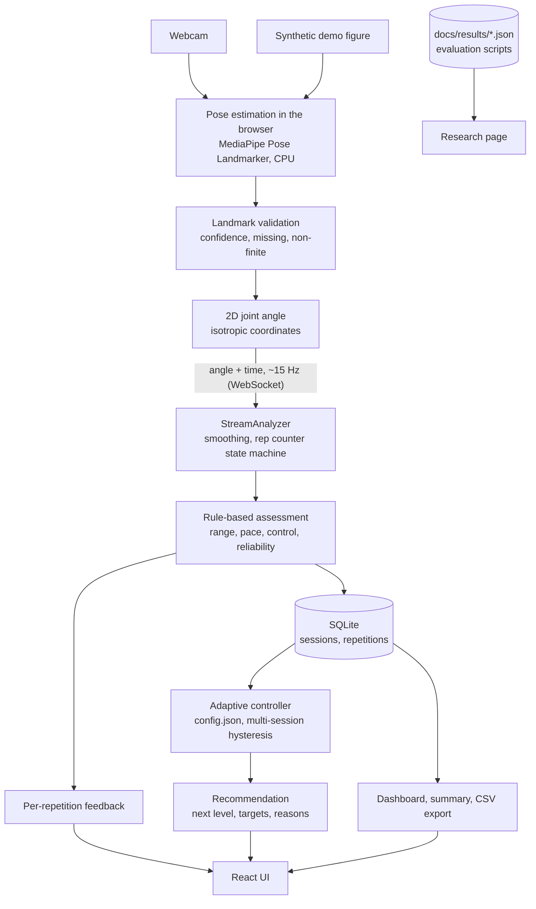

# Architecture

ARVR is a local web application: a React/TypeScript frontend that runs pose estimation in the browser, and a FastAPI backend (Python) that
counts repetitions, assesses movement quality, adapts difficulty, stores sessions in SQLite, and serves research results. Everything runs on one
computer; no cloud service, paid API or special hardware is needed.

## Design rules
- **The camera and pose estimation never depend on React internals or the backend.** `frontend/src/pose/` exposes a `PoseEstimator` interface (MediaPipe and the synthetic demo implement it), so the model can be replaced.
- **Decisions live in the backend.** The browser only sends joint-angle numbers; counting, assessment and adaptation are Python and testable without a camera or UI.
- **The adaptive controller is independent**: `backend/app/personalization/controller.py` has no database, camera or HTTP code; it is driven by `adaptive_service.py` and the API.
- **Exercises are data**: JSON files in `backend/app/exercises/definitions/`. Adding an exercise needs no code change.
- **Privacy by construction**: no video leaves the browser; only numbers go to a backend on the same machine; demo and guest sessions are never saved to history; accounts can be deleted completely.

## Where things are
| Concern | Location |
|---|---|
| Pose estimators, skeleton drawing, angle maths (display) | `frontend/src/pose/` |
| Pages, charts, account, record-data tool | `frontend/src/pages/`, `components/`, `collect/` |
| Angle maths (authoritative), smoothing | `backend/app/angle_calculation/` |
| Repetition counter, features, posture features | `backend/app/repetition_detection/`, `feature_extraction/` |
| Rule-based assessment | `backend/app/exercise_assessment/` |
| Live pipeline (`StreamAnalyzer`) | `backend/app/services/analysis.py` |
| Adaptive controller, config, simulation | `backend/app/personalization/` |
| API, auth, persistence | `backend/app/api/`, `core/`, `database/` |
| ML pipeline, importers, evaluations | `backend/app/ml/` |
| Evaluation results (aggregate only) | `docs/results/` |

## Coordinate conventions
- Landmarks are MediaPipe's 33-point layout. Image coordinates are **normalised separately per axis** (x by width, y by height; y grows downward). Before any angle is computed, x is multiplied by width/height (`isotropic()` in the frontend, the same correction in the importers) so both axes share a scale. Skipping this distorts angles on non-square video.
- Angles are **2D image-plane angles at a joint between three landmarks**, in degrees. They are not 3D anatomical angles and not clinical measurements.
- A landmark with visibility below 0.5, a non-finite value, or a zero-length segment gives **no angle** (null), never a guess.
- Repetition progress is normalised: 0 at the exercise's start angle, 1 at its (illustrative) target angle, so increasing and decreasing movements are handled alike.

## Live data flow
1. Browser: camera frame -> MediaPipe -> landmarks -> exercise angle (isotropic) -> `{t, angle|null}` message about every 66 ms.
2. `WS /api/ws/analysis`: `StreamAnalyzer.push()` smooths, runs the counter state machine (rest -> moving out -> target -> returning), and replies with a `state` message per frame and a `rep` message when a repetition ends (with label, score, reason, one feedback message).
3. If the session was created with a per-session key, each finished repetition is saved server-side.
4. `POST /api/sessions/{id}/complete` summarises the session, asks the controller for a recommendation using the user's history (signed-in, non-demo sessions only), stores the decision, and returns both.

## Failure handling
| Situation | Behaviour |
|---|---|
| Camera permission denied / no camera / camera unplugged | clear message; camera stopped; the synthetic demo still works |
| Pose model file missing | explicit error naming the download script; no silent fake output |
| No person or low-confidence landmarks | angle is null; "pose not detected clearly" after 1 s; repetitions with too few valid frames are labelled `insufficient_data` and never raise difficulty |
| Backend unreachable | pose and skeleton keep working; page says reps are not counted; banner in the layout |
| WebSocket drops | session can still be completed with the repetitions already saved |
| Bad input | validated at the API boundary (HTTP 404/409/422, WebSocket close codes 4403/4404/4422) |
| Old local database | columns are added in place on startup, no data loss (tested) |
| 3D / AR modes | not part of this version (see `docs/implementation-status.md`) |
